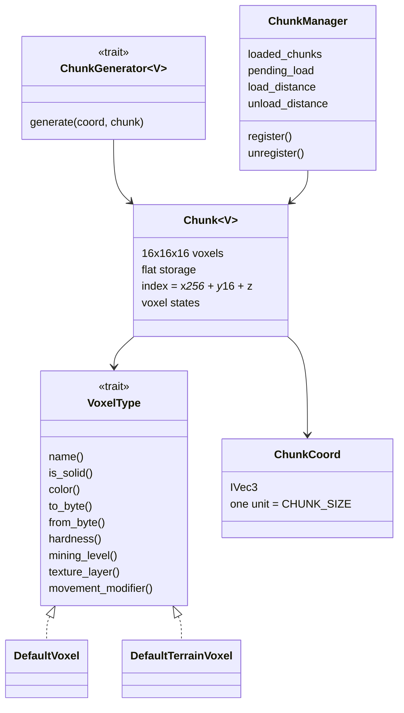
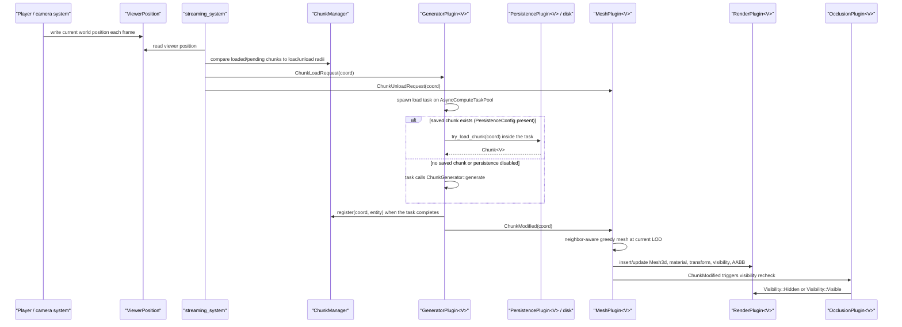
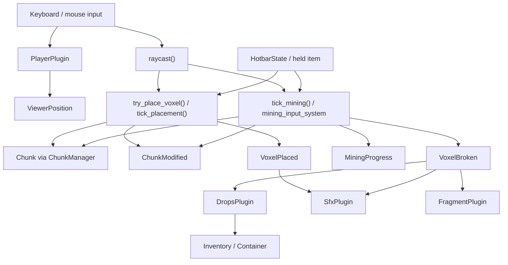
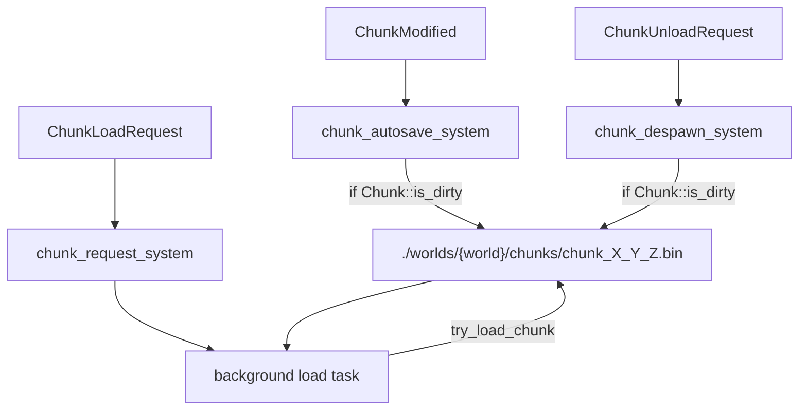

# voxel-framework Architecture

This document is the textual architecture model for `voxel-framework` as
implemented in the current codebase. It is intentionally versioned as Markdown:
the diagrams are Mermaid source, not exported images, so the model stays
reviewable in diffs and useful to software architects at a glance.

`voxel-framework` is a reusable Bevy library crate. It is not a game and does
not own a `main.rs`; a consumer game composes the framework plugins it needs.

## Source-of-truth note

The active formal OpenSpec capabilities currently present under
`openspec/specs/` are:

- `player`
- `items`

Cross-cutting architecture such as chunk streaming, generation, meshing,
rendering, occlusion, and persistence is currently documented primarily in
Rustdoc and module-level docs under `src/`. Treat this document as the
high-level architectural map and the Rust modules as the detailed runtime
contract until those capabilities get formal specs.

## Plugin catalog overview

The public architecture is a **flat Bevy plugin catalog grouped by
responsibility**. A game crate imports the public API, then selects plugins
from the categories it needs.

`VoxelCorePlugin<V>` and `VoxelPlugin<V>` still exist, but they are
**convenience bundles** for compatibility, examples, and quick starts. They are
not the primary model for understanding the framework.

```mermaid
flowchart TD
    Game["Consumer Bevy game"]
    Prelude["voxel_framework::prelude::*"]

    Game --> Prelude

    Game --> Engine["Engine"]
    Game --> WorldData["World Data"]
    Game --> Gameplay["Gameplay"]
    Game --> Defaults["Default Implementation"]
    Game --> Convenience["Convenience"]

    Engine --> World["WorldPlugin"]
    Engine --> WorldConfig["WorldConfigPlugin"]
    Engine --> Render["RenderPlugin<V>"]
    Engine --> Mesh["MeshPlugin<V>"]
    Engine --> Occlusion["OcclusionPlugin<V>"]
    Engine --> Loading["LoadingPlugin"]

    WorldData --> Generator["GeneratorPlugin<V>"]
    WorldData --> MultiGenerator["MultiGeneratorPlugin<V>"]
    WorldData --> Persistence["PersistencePlugin<V>"]
    WorldData --> Manifest["WorldManifestPlugin<V, I>"]

    Gameplay --> Mining["MiningPlugin"]
    Gameplay --> Placement["PlacementPlugin"]
    Gameplay --> Player["PlayerPlugin<V>"]
    Gameplay --> Hotbar["HotbarPlugin"]
    Gameplay --> Drops["DropsPlugin<I>"]
    Gameplay --> Crafting["CraftingPlugin<I>"]
    Gameplay --> Mobs["MobPlugin<V>"]
    Gameplay --> Effects["StatusEffectsPlugin<E>"]

    Defaults --> Fragments["FragmentPlugin"]
    Defaults --> Skybox["SkyboxPlugin"]
    Defaults --> Sfx["SfxPlugin"]
    Defaults --> Audio["DefaultAudioPlugin"]
    Defaults --> Ui["UiPlugin + UI subplugins"]
    Defaults --> DayCycle["DayCyclePlugin"]

    Convenience --> CoreBundle["VoxelCorePlugin<V>"]
    Convenience --> QuickStart["VoxelPlugin<V>"]
    Convenience --> MiningInput["MiningInputPlugin<V, I>"]
    Convenience --> PlacementInput["PlacementInputPlugin<V>"]
    Convenience --> CraftingUi["CraftingUiPlugin<I>"]
```

The categories are official API concepts represented by marker traits in
`src/plugin_category.rs`:

| Category | Marker trait | Meaning |
|---|---|---|
| Engine | `EnginePlugin` | Foundation/infrastructure for streamable, renderable voxel worlds |
| World Data | `WorldDataPlugin` | Chunk sources, generation, persistence, manifest/lifecycle data |
| Gameplay | `GameplayPlugin` | Reusable rules and interactions |
| Default Implementation | `DefaultImplementationPlugin` | Replaceable UI/audio/visual/presentation defaults |
| Convenience | `ConveniencePlugin` | Exceptional bundles, input adapters, compatibility layers, recipes, and prototyping helpers |

Convenience is intentionally exceptional. New domain behavior should start in
Engine, World Data, Gameplay, or Default Implementation. A Convenience plugin
must document what it composes or adapts; it should not become a dumping ground
for unclassified behavior.

`GeneratorPlugin<V>` and `PersistencePlugin<V>` remain explicit world-data
choices. An app without `GeneratorPlugin<V>` and a `GeneratorResource<V>` can
run framework systems, but it will not generate new chunks.

## Current plugin catalog

| Category | Plugins |
|---|---|
| Engine | `WorldPlugin`, `WorldConfigPlugin`, `RenderPlugin<V>`, `MeshPlugin<V>`, `OcclusionPlugin<V>`, `LoadingPlugin` |
| World Data | `GeneratorPlugin<V>`, `MultiGeneratorPlugin<V>`, `PersistencePlugin<V>`, `WorldManifestPlugin<V, I>` |
| Gameplay | `MiningPlugin`, `PlacementPlugin`, `PlayerPlugin<V>`, `HotbarPlugin`, `DropsPlugin<I>`, `CraftingPlugin<I>`, `MobPlugin<V>`, `StatusEffectsPlugin<E>` |
| Default Implementation | `FragmentPlugin`, `SkyboxPlugin`, `SfxPlugin`, `DefaultAudioPlugin`, `UiPlugin`, `CrosshairPlugin`, `LoadingScreenPlugin`, `HotbarUiPlugin`, `PickupNotificationPlugin<I>`, `PauseMenuPlugin`, `DebugOverlayPlugin`, `DayCyclePlugin` |
| Convenience | `VoxelCorePlugin<V>`, `VoxelPlugin<V>`, `MiningInputPlugin<V, I>`, `PlacementInputPlugin<V>`, `CraftingUiPlugin<I>` |

Feature-gated plugins only exist when their Cargo features are enabled:
`items` gates item/hotbar/drop UI pieces, `crafting` gates crafting and world
manifest helpers, and `mobs` gates mob AI.

## Compatibility and quick-start bundles

`VoxelCorePlugin<V>` remains the historical core bundle. It composes Engine
plugins plus the lightweight Gameplay primitives `MiningPlugin` and
`PlacementPlugin`. This is preserved for compatibility, but it should not be
described as a pure Engine category plugin.

`VoxelPlugin<V>` remains the quick-start bundle for examples and prototypes. It
composes `VoxelCorePlugin<V>` with selected defaults such as fragments, skybox,
SFX events, hotbar state when `items` is enabled, and UI. It is convenient, but
not "the full framework": generation, persistence, player, drops, crafting,
mobs, input adapters, and playback defaults are still explicit choices.

## Core conceptual model

The framework is generic over `V: VoxelType`. `DefaultVoxel` and
`DefaultTerrainVoxel` are built-in palettes, but consumer games can provide
their own palette as long as they preserve the `VoxelType` invariants.

## Runtime pipeline: streaming, generation, persistence, mesh, render, occlusion

The main event bus is:

- `ChunkLoadRequest` — produced by streaming, consumed by generation.
- `ChunkUnloadRequest` — produced by streaming, consumed by chunk despawn.
- `ChunkModified` — produced by generation, restore, voxel edits and remesh
  requests; consumed by mesh, persistence, LOD/neighbor remesh propagation,
  and occlusion. Persistence acts on it only for chunks with unsaved changes.

Generation is two-stage: request dispatch spawns work on
`AsyncComputeTaskPool`, then a poll system attaches the completed `Chunk<V>` to
the ECS entity and registers it with `ChunkManager`.

## Interaction flow: player, mining, placement, items

Mining and placement are intentionally not hidden game loops. The framework
provides resources, messages, and callable functions such as `tick_mining`,
`stop_mining`, `try_place_voxel`, and `tick_placement`. A consumer game can
wire those functions into its own input systems, or use the framework input
plugins when the relevant feature is enabled.

## Persistence flow

`PersistencePlugin<V>` inserts `PersistenceConfig` and registers auto-save on
`ChunkModified`. Only chunks with unsaved changes (`Chunk::is_dirty`) are
written, by auto-save or when they unload; generated and restored chunks start
clean. The generator pipeline's background task checks disk first when
`PersistenceConfig` exists; if no saved chunk is found, it falls back to the
configured `ChunkGenerator<V>`. Without a generator the saved chunk is read
directly by `chunk_request_system<V>`.

The chunk binary format is palette-byte based. `VoxelType::to_byte` and
`VoxelType::from_byte` therefore form a save compatibility contract.

## Player modes

`PlayerPlugin<V>` supports three complete movement/look experiences through
`PlayerConfig::mode`:

- `PlayerMode::FreeFlightSixDof { roll_mode }` — zero-g 6DOF, Q/E roll.
- `PlayerMode::FreeFlightAnchored` — free flight with horizon anchored to one
  signed world axis; Q/E switch the anchor.
- `PlayerMode::Grounded { gravity, jump_speed }` — gravity-based movement and
  jumping.

`PlayerConfig::mode` is copied into the spawned `Player`. Runtime mode switching
is not a documented public contract yet.

## Current runtime contracts and gotchas

1. `ViewerPosition` drives streaming. If a game does not update it every frame,
   chunk loading remains centered on the last written position.
2. `GeneratorResource<V>` is required for procedural generation. Without it,
   `GeneratorPlugin<V>` skips load requests that miss persistence.
3. `ChunkGenerator::generate` runs on a background worker and must not touch the
   Bevy `World`, `Commands`, `Res`, or `Query`.
4. Chunks are always `16×16×16`; flat voxel index is `x * 256 + y * 16 + z`.
5. `VoxelType::to_byte/from_byte` and `ItemType::to_byte/from_byte` are stable
   persistence contracts. Changing byte assignments can break saved worlds or
   inventories.
6. World configuration is loaded from `world.toml` in the process working
   directory. Missing or malformed config falls back to defaults.
7. LOD currently has two levels: LOD 0 uses step 1 below 200 units; LOD 1 uses
   step 2 at or beyond 200 units, with hysteresis to avoid boundary thrash.
8. Occlusion is neighbor-solid occlusion, not camera-frustum culling: a chunk is
   hidden only when all six face-adjacent neighbors are loaded and fully solid.
9. Mining and placement mutate loaded chunks and emit `ChunkModified`; border
   edits also notify affected neighbor chunks so meshes can expose or hide faces.
10. `VoxelPlugin<V>` is convenient but not magic: generation and persistence are
    still opt-in, because both depend on the concrete voxel type and world data
    choices.

## Current limits / extension seams

- Formal specs do not yet cover every architectural capability. Player and
  Items are spec'd; streaming, generator, mesh, persistence, render, and
  occlusion currently rely on Rustdoc/module docs.
- Runtime player mode switching is not a documented public feature.
- The occlusion system hides chunks surrounded by solid neighbors; it does not
  perform general visibility determination from a camera.
- LOD is intentionally coarse: only two effective mesh steps are used today.
- Generators are isolated from ECS by design. If generation needs game state,
  that state must be copied into a `Send + Sync` generator object/resource
  before background work starts.

## Key files

| Path | Architectural role |
|---|---|
| `src/lib.rs` | Public crate overview, top-level plugin composition |
| `src/prelude.rs` | Public convenience re-exports |
| `src/voxel.rs` | `VoxelType`, default palettes, palette-byte persistence contract |
| `src/chunk/` | `Chunk<V>`, coordinates, LOD marker, low-level chunk persistence |
| `src/world/` | Streaming, lifecycle messages, config, persistence, raycast, collision, mining, placement, occlusion |
| `src/generator/` | `ChunkGenerator<V>`, async generation pipeline, multi-generator composition |
| `src/mesh/` | Neighbor-aware greedy meshing, LOD, chunk despawn/render component updates |
| `src/render/` | Chunk materials and render integration |
| `src/player/` | Player plugin, modes, movement/look/collision/health |
| `src/items/` | Inventory, hotbar, drops, pickup, item persistence |
| `openspec/specs/player/spec.md` | Active formal Player capability spec |
| `openspec/specs/items/spec.md` | Active formal Items capability spec |
